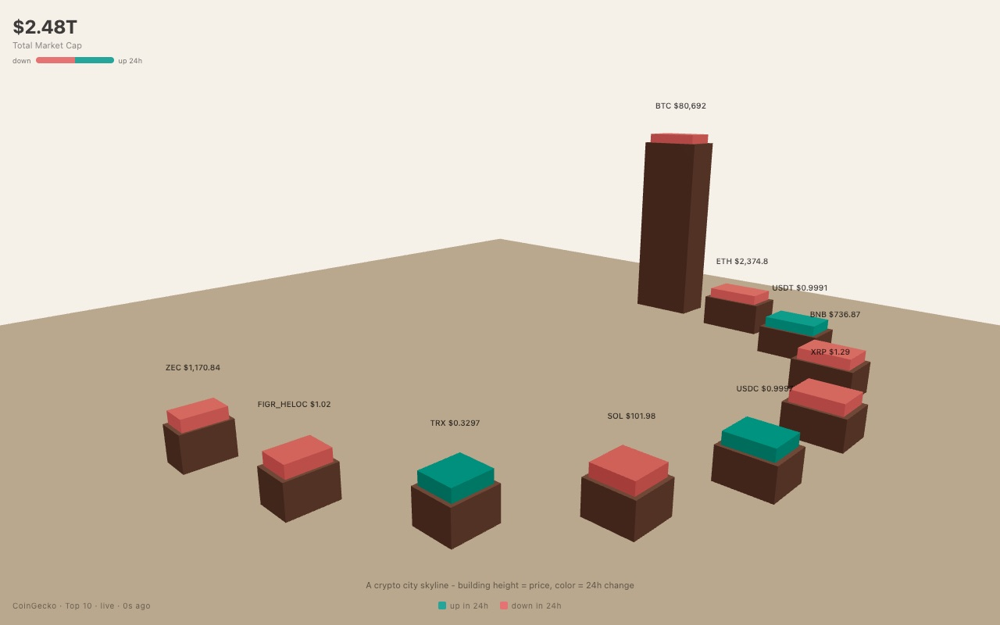

<div align="center">

<h1>Skyline</h1>

<p><b>The top ten cryptocurrencies as a 3D city.</b></p>

<p><i>Price sets how tall each building stands; the roof turns green or red with the last 24 hours.</i></p>

<h6>


</h6>

<a href="https://skyline.parthchandak.info"><b>Live demo</b></a> ·
<a href="#how-it-works"><b>How it works</b></a> ·
<a href="#run-it"><b>Run it</b></a>

<br><br>

<a href="https://skyline.parthchandak.info"></a>

<sub>Live capture, 23 October 2026. Real CoinGecko prices.</sub>

</div>

<br>

Ten buildings stand in a half-circle on warm sand, one per coin in CoinGecko's top ten by
market cap. Each is labelled with its symbol and price, and the headline top-left adds up their
market caps. The page shows built-in sample prices immediately, then swaps in live numbers from
the public CoinGecko API and refreshes them every 60 seconds. No API key is needed.

## How it works

| CoinGecko field (`/coins/markets`) | Drives |
|---|---|
| `current_price` | Building height, scaled between the cheapest and dearest coin in the set |
| `market_cap_rank` | Building width: rank 1 is widest, rank 10 narrowest |
| `price_change_percentage_24h` | Roof colour: teal if up or flat, red if down |
| `market_cap` (summed) | The total in the top-left corner |

Height is linear in price, so Bitcoin towers over the rest and anything under a few dollars sits
at the minimum height. When new data arrives, heights and roof colours ease toward their new
values rather than jumping. If the request fails, the stamp at the bottom-left reads `fallback`
instead of `live`. Both legends read the same way: red for down, teal for up.

Drag to orbit, scroll to zoom. Click a building for a card with its name, price, 24-hour change,
rank and market cap; it fades after three seconds.

## Run it

```bash
git clone https://github.com/parthchandak02/skyline.git
cd skyline
npm install
npm run dev      # local dev server
npm run build    # type-check, then static site in dist/
```

<details>
<summary><b>Project layout</b></summary>

```
src/main.ts     Everything: config, palette, scene, buildings, CoinGecko polling, click card
index.html      Canvas host, overlay styles and containers
brief.md        The original creative brief
vite.config.ts  Relative base path for static hosting
```

Tunables (heights, widths, arc radius, poll interval, easing) are in the `C` object at the top of
`src/main.ts`; colours are in `PALETTE`.

</details>

<br>

<div align="center">
<sub>Built with Three.js, TypeScript and Vite. Data from CoinGecko.</sub>
</div>
